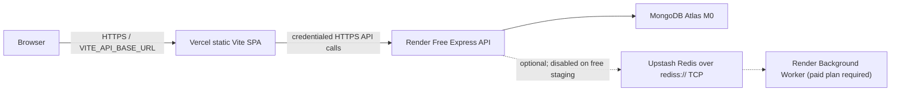

# MailFlow staging deployment handoff

This is a staging/demo deployment guide, not a production-readiness claim. No cloud
resources or deployments have been created. The free Render web service sleeps
when idle, uses ephemeral storage, and cannot host the required continuously
running background worker on its Free compute plan.

## Architecture

For the initial ₹0 staging setup, keep queue features disabled. Campaign send,
scheduling, and other features that require a continuously running worker must
not be represented as operational until a worker and Redis are configured and
the worker heartbeat is visible to the API.

## Vercel frontend

- **Root directory:** `client`
- **Framework preset:** Vite
- **Build command:** `npm run build`
- **Output directory:** `dist`
- **Environment variable:** `VITE_API_BASE_URL=https://<render-service>.onrender.com/api/v1`
- `VITE_API_BASE_URL` is public configuration, not a secret. Do not put backend
  credentials in any `VITE_*` variable.
- [client/vercel.json](./client/vercel.json) rewrites nested React Router paths
  to `/index.html`, so refreshing a route such as `/campaigns` loads the SPA.

Set `CLIENT_URL` on Render to the exact Vercel production origin, without a
trailing path (for example, `https://mailflow-demo.vercel.app`). Preview deploy
origins are intentionally not allowed unless explicitly configured.

## Render API

The checked-in [render.yaml](./render.yaml) describes the API service:

- **Service root:** repository root (`.`), required so npm can use the root
  workspace lockfile.
- **Build command:** `npm ci`
- **Start command:** `npm run start --workspace=server`
- **Health-check path:** `/api/v1/health`
- **Bind address/port:** the server binds `0.0.0.0` and uses Render's `PORT`.
- **Plan:** Free web service for staging only; it is not an always-on API.

Equivalent manual dashboard configuration is the same. Render's Free web
services spin down after 15 minutes without inbound traffic and wake on a
subsequent request; the first request can take about a minute. Free services
have an ephemeral filesystem and a monthly included instance-hour allowance.
Do not store uploads, database files, or other persistent state on the service.

The API now refuses production startup if MongoDB or required production secrets
are missing or invalid. `/api/v1/health` reports `503` until MongoDB is ready;
when queue features are enabled, a live Redis connection and recent worker
heartbeat are also required for `200`.

## MongoDB Atlas

1. Create a dedicated staging project and an M0/free cluster in Atlas.
2. Create a database user limited to the MailFlow database and required
   read/write operations. Use a unique generated password.
3. Configure Atlas Network Access using the outbound IP ranges shown for the
   Render service where possible. If the chosen free setup cannot be restricted
   to stable Render egress IPs, any broader allowlist is a staging-only
   trade-off: use the least-privilege database user, TLS, and rotate credentials.
4. Put the complete Atlas URI in Render's `MONGODB_URI`; URL-encode special
   characters in the database username/password. Never commit it or use real
   user data for deployment checks.
5. Keep backups/export procedures separate from application deployment. Do not
   run destructive migrations or reset commands against existing data.

Atlas free-tier capacity, backup options, and limits can change; confirm current
terms in the Atlas dashboard before relying on them.

## Redis and workers

Phase 9 scheduling and BullMQ workers exist in the repository. The Render Free
plan does **not** offer free Background Worker instances; Render's free-instance
documentation lists web services, static sites, Postgres, and Key Value, and
states that other service types do not support Free instances. Therefore:

- Keep `QUEUE_FEATURES_ENABLED=false` on the initial free staging API.
- Do not deploy the API's `worker` script as a web service or substitute an
  in-memory scheduler.
- Campaign send/scheduling endpoints return `503` in production until a
  dedicated worker is deployed and its Redis heartbeat is current.
- When using a paid Render Background Worker, set its root to the repository
  root, build with `npm ci`, and start with `npm run worker --workspace=server`.
  Give it the same MongoDB, JWT, encryption, OAuth, and Redis configuration as
  the API. Configure one worker instance for the shared readiness heartbeat.
- For a future Upstash BullMQ deployment, use its TLS-enabled **Redis TCP**
  connection string in `REDIS_URL`, typically in `rediss://default:<password>@<host>:<port>`
  form. Do not use the Upstash REST URL/token or the HTTP SDK. The API and worker
  must use the same Redis database and queue names. The server validates
  `rediss://` when production queue features are enabled.

Redis is optional for the free staging API and is not included in the starter
Render Blueprint.

## CORS, authentication, and cookies

- `CLIENT_URL` is the only allowed browser origin in production; development
  additionally allows `localhost:5173` and `127.0.0.1:5173`.
- Credentialed requests are enabled for the refresh-token cookie. Wildcard
  origins are not used; requests from other browser origins receive no CORS
  permission.
- The refresh token is only set as an `HttpOnly` cookie at `/api/v1/auth`; it is
  not returned in JSON or stored in browser local storage.
- `Secure` is enabled in production. `COOKIE_SAME_SITE=none` is the production
  default for the cross-site Vercel/Render hostnames. Keep the cookie host-only
  (no `Domain` override). With custom frontend/API domains on the same
  registrable domain, `lax` may be appropriate, but test browsers and OAuth
  flows before changing it.
- The frontend Axios client sends credentials. The access token remains a
  short-lived bearer token; rotate JWT secrets only with a planned session
  invalidation.

## Transactional email

Render Free blocks outbound SMTP ports 25, 465, and 587. Do not configure Gmail
SMTP and assume it will work. The existing Gmail mailbox provider uses OAuth
mailbox delivery for campaigns; it is not the transactional-email provider.

HTTPS Resend and Sendliberty adapters are available for transactional messages:

1. For Resend, verify a sender domain/address and set `EMAIL_PROVIDER=resend`,
    `RESEND_API_KEY`, and `SMTP_FROM_EMAIL`.
2. For Sendliberty, connect the Gmail sender in its dashboard, create an API
    key, and set `EMAIL_PROVIDER=sendliberty`, `SENDLIBERTY_API_KEY`, and
    `SENDLIBERTY_FROM_EMAIL`. The sender address must be connected and the API
    key must be restricted/configured for that sender. `SMTP_FROM_NAME` is not
    used by Sendliberty; include a display name in `SENDLIBERTY_FROM_EMAIL` if
    desired.
3. Until a provider and verified/connected sender are configured,
   transactional-email flows that must send a message return `503`. Production
   never falls back to console previews. Delivery errors are surfaced and do
   not produce a success-shaped response.
4. Console email previews remain available only in local development.

Provider quotas, domain verification, and pricing are external dependencies;
verify them directly before enabling registration or password-reset workflows.
No provider has been tested with live credentials in this handoff.

### Sendliberty campaign routing

Campaigns continue to use connected Gmail/Outlook mailbox delivery by default.
To route campaigns through Sendliberty, set
`CAMPAIGN_EMAIL_PROVIDER=sendliberty` with `SENDLIBERTY_API_KEY` and
`SENDLIBERTY_FROM_EMAIL`. Campaigns must select a connected Gmail sender whose
address matches that configured sender; Outlook accounts are not accepted for
this route. Sends use Sendliberty's single-message API, are serialized and
paced within one worker process, and retry rate-limited requests using the
provider's `Retry-After`. Run only one MailFlow worker for that sender; the
in-process pacing does not coordinate multiple worker instances. Other
provider failures are reported through the campaign's recipient status.

Sendliberty's own guidance warns against newsletters and heavy marketing blasts.
Use this route only for small, low-volume, personalized campaigns to opted-in
recipients, and confirm its current plan limits before enabling it. A continuous
MailFlow campaign worker still requires a hosting plan that supports background
workers; Render Free is not sufficient.

## Environment variable inventory

Values marked secret must be set in the hosting dashboard, never committed.
Optional does not mean safe to guess; keep a feature disabled until its required
values are configured.

### Vercel

| Variable | Required | Secret? | Source / use |
|---|---:|---:|---|
| `VITE_API_BASE_URL` | Yes | No | Render API URL ending in `/api/v1`; bundled into the public frontend. |

### Render API

| Variable | Required | Secret? | Source / use |
|---|---:|---:|---|
| `NODE_ENV` | Yes | No | Set to `production`; Blueprint sets this. |
| `PORT` | Platform-provided | No | Render injects this; do not hardcode a deployed port. |
| `CLIENT_URL` | Yes | No | Exact deployed Vercel origin; also used for auth email links and CORS. |
| `MONGODB_URI` | Yes | Yes | Atlas connection string for the dedicated staging DB user. |
| `JWT_ACCESS_SECRET` | Yes | Yes | Generate with `node -e "console.log(require('crypto').randomBytes(48).toString('hex'))"`. |
| `JWT_REFRESH_SECRET` | Yes | Yes | Generate independently using the same command. |
| `ENCRYPTION_KEY` | Yes | Yes | Exactly 64 hex characters; generate with `node -e "console.log(require('crypto').randomBytes(32).toString('hex'))"`. |
| `JWT_ACCESS_EXPIRES_IN` | Optional | No | Defaults to `15m`. |
| `JWT_REFRESH_EXPIRES_IN` | Optional | No | Defaults to `7d`. |
| `COOKIE_SAME_SITE` | Optional | No | Defaults to `none` in production; use `none` for Vercel/Render cross-site cookies. |
| `API_BASE_URL` | Optional | No | Accepted by server config; currently not used by request routing. Set to the Render API origin if retained. |
| `EMAIL_PROVIDER` | Optional | No | `disabled` by default in production; select `resend` or `sendliberty` only after configuring its key and sender. |
| `RESEND_API_KEY` | Required for Resend | Yes | Resend dashboard API key. |
| `SENDLIBERTY_API_KEY` | Required for Sendliberty | Yes | Server-only Sendliberty API key; never put it in Vercel or frontend variables. |
| `SENDLIBERTY_FROM_EMAIL` | Required for Sendliberty | No | Connected Sendliberty Gmail address; campaigns require a matching Gmail mailbox account. May include a display name. |
| `CAMPAIGN_EMAIL_PROVIDER` | Optional | No | `mailbox` by default; `sendliberty` routes campaigns through Sendliberty and requires its API key/sender. |
| `SMTP_FROM_EMAIL` | Required for Resend | No | Verified Resend sender address. Despite the legacy name, used by Resend too. |
| `SMTP_FROM_NAME` | Optional | No | Sender display name; defaults to `MailFlow Team`. |
| `SMTP_HOST`, `SMTP_PORT`, `SMTP_SECURE`, `SMTP_USER`, `SMTP_PASS` | Optional | Host/port/secure: No; user/pass: Yes | Only for a non-Render-free SMTP deployment. Do not use Render Free SMTP. |
| `GOOGLE_CLIENT_ID`, `GOOGLE_CLIENT_SECRET`, `GOOGLE_CALLBACK_URL` | Optional | Secret: client secret | Google Cloud OAuth app for Gmail mailbox integration; callback must match the exact URI used by the existing OAuth flow. |
| `MICROSOFT_CLIENT_ID`, `MICROSOFT_CLIENT_SECRET`, `MICROSOFT_CALLBACK_URL` | Optional | Secret: client secret | Microsoft Entra app for Outlook mailbox integration. |
| `GITHUB_CLIENT_ID`, `GITHUB_CLIENT_SECRET`, `GITHUB_CALLBACK_URL` | Optional | Secret: client secret | Accepted by config/OAuth status; verify the corresponding application flow before enabling. |
| `QUEUE_FEATURES_ENABLED` | Optional | No | Keep `false` on free staging. Set true only with a working paid worker and Redis. |
| `REDIS_URL` | Required only when queues are enabled | Yes | Upstash TLS Redis TCP URL (`rediss://`), shared with the worker; never a REST URL. |
| `REDIS_HOST`, `REDIS_PORT`, `REDIS_PASSWORD`, `REDIS_DB` | Optional local connection fields | Password: Yes | Local/non-production Redis settings; production queue mode uses `REDIS_URL`. |

### Render worker

If a paid Background Worker is added, provide the production runtime variables
above that its code requires: `NODE_ENV`, `CLIENT_URL`, `MONGODB_URI`, both JWT
secrets, `ENCRYPTION_KEY`, and the same `REDIS_URL`. Add provider-specific
Google/Microsoft OAuth values for mailbox jobs. Set `QUEUE_FEATURES_ENABLED=true`
on the API and worker only after the worker starts successfully. `PORT`,
`COOKIE_SAME_SITE`, and `API_BASE_URL` are not needed by worker execution.

### MongoDB, Redis, and email values

- Atlas supplies the `MONGODB_URI`; do not store the database password in a
  Vercel variable or a committed file.
- Upstash supplies the Redis TCP host, port, and password used to form
  `REDIS_URL`; the Redis REST URL and REST token are not used by BullMQ.
- Resend supplies `RESEND_API_KEY`; configure `SMTP_FROM_EMAIL` to a verified
  sender address.
- Sendliberty supplies `SENDLIBERTY_API_KEY`; keep it backend-only and configure
  `SENDLIBERTY_FROM_EMAIL` to a Gmail sender connected in the Sendliberty
  dashboard. The provider should not be used for high-volume newsletters.
- Google/Microsoft OAuth credentials are only needed for corresponding
  mailbox integrations and remain server-side.

## Deployment sequence

1. Review the current free-tier limits and create Atlas, Render, Vercel, and
   (only if needed later) Upstash accounts. Do not create resources without
   approval.
2. Configure Atlas user/network access and put `MONGODB_URI` in Render.
3. Set the required production secrets (`JWT_ACCESS_SECRET`,
   `JWT_REFRESH_SECRET`, `ENCRYPTION_KEY`) and exact `CLIENT_URL`. Keep
   `QUEUE_FEATURES_ENABLED=false` and `EMAIL_PROVIDER=disabled` until those
   integrations are ready.
4. Deploy the Render API using the Blueprint/manual commands. Confirm
   `/api/v1/health` returns 200 and does not expose credentials.
5. Configure Vercel with root `client`, `VITE_API_BASE_URL`, build command, and
   `dist` output. Deploy and test a nested route refresh.
6. If transactional email is needed, configure Resend and verify registration,
   password reset, and provider error handling using controlled test accounts.
7. Leave sending/scheduling disabled unless Redis TCP and a healthy background
   worker are both operating.
8. Test login, cookie refresh, logout, CORS rejection from an unapproved origin,
   and workspace isolation using test-only accounts and data.

## Essential checks and limitations

- Frontend production build: `npm run build --workspace=client`
- Backend start: `npm run start --workspace=server`
- Worker (paid deployment only): `npm run worker --workspace=server`
- Health: `GET https://<render-service>.onrender.com/api/v1/health`
- Database connectivity cannot be externally verified without a valid Atlas
  URI; a production API without it intentionally refuses startup.
- Contact import uses Multer memory storage and does not persist uploaded files.
- Do not send live bulk campaigns or use real users' data during staging checks.
- Render Free has no free continuous Background Worker; scheduled jobs are
  unavailable on the ₹0 deployment. Free services may sleep and have ephemeral
  filesystems. Vercel, Atlas, Upstash, and email-provider quotas/prices can
  change; confirm current limits in each dashboard.

## Troubleshooting

- **Render health check is 503:** Check `MONGODB_URI`, Atlas network access,
  database credentials, and Render logs. With queues enabled, also check Redis
  connectivity and the worker heartbeat.
- **Browser CORS error:** Ensure `CLIENT_URL` exactly matches the deployed
  frontend origin, including scheme and hostname. Preview deployments are not
  allowed by default.
- **Refresh/login loops:** Confirm browser credentials are enabled, HTTPS is
  used, `COOKIE_SAME_SITE=none` for cross-site hosts, and the cookie is
  HttpOnly/Secure at `/api/v1/auth`. Browser third-party-cookie restrictions
  may require custom same-site domains.
- **Verification/reset email returns 503/502:** Configure `EMAIL_PROVIDER`,
  provider credentials, and a verified sender; Render Free SMTP is not an
  alternative.
- **Campaign send/schedule returns 503:** This is expected unless
  `QUEUE_FEATURES_ENABLED=true`, the API and worker share a live `rediss://`
  connection, and the worker heartbeat is current.
- **First API request is slow:** The Render Free web service may have spun down.

## Rollback

Use Render's dashboard rollback to one of the most recent successful API
deploys and Vercel's deployment rollback for the frontend. Revert environment
variables only to known-compatible values. Do not restore an old encryption
key if OAuth tokens were written with a newer key, and do not reset or restore
Atlas data as part of an application rollback.

## External references

- [Render free-instance limits](https://render.com/docs/free)
- [Render background workers](https://render.com/docs/background-workers)
- [Render Node/Express deployment](https://render.com/docs/deploy-node-express-app)
- [Vercel Vite deployments](https://vercel.com/docs/frameworks/frontend/vite)
- [Upstash REST client reference (not used by BullMQ)](https://upstash.com/docs/redis/sdks/ts/overview)
- [ioredis TCP connection configuration](https://github.com/redis/ioredis#connect-to-redis)
